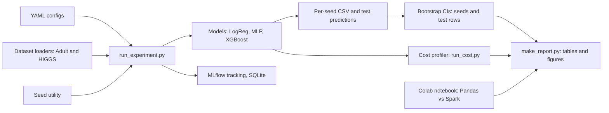
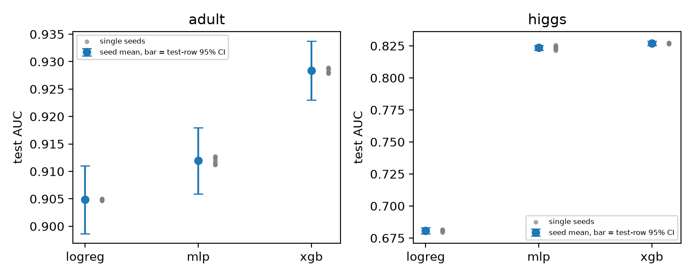
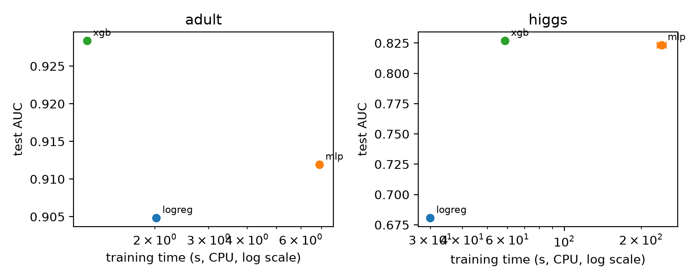
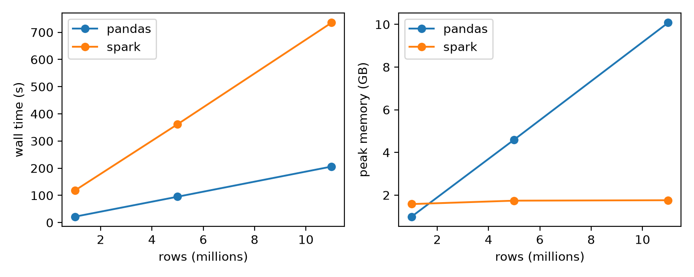

# MLBench

A small, reproducible benchmarking framework that compares models on three axes at once: predictive performance, computational cost, and statistical reliability. It trains three models (logistic regression and an MLP in PyTorch, and XGBoost) on two tabular datasets, repeats every run over 10 seeds, and reports bootstrap confidence intervals next to the point estimates. A separate Colab experiment compares Pandas and PySpark preprocessing on up to 11 million rows.

Author: Disha Sharma (dishasharma.0626@gmail.com)

## What is measured

| Axis | How |
| --- | --- |
| Predictive performance | Test accuracy, AUC, F1 and log loss, 10 training seeds per model and dataset, on a fixed train/validation/test split |
| Statistical reliability | Two separate intervals: a bootstrap over seeds (training randomness) and a bootstrap over test rows (test-set sampling), plus paired model differences |
| Computational cost | Training time, inference throughput, per-call latency (p50 and p95 at batch sizes 1 and 1024) and peak process memory, on CPU |
| Data engineering | Pandas vs PySpark preprocessing at 1M, 5M and 11M rows, a Spark partition sweep, and CSV vs Parquet read times |

## Architecture



## Results

All numbers below are from the committed result files in `results/` (CPU, fixed split, seeds 0 to 9).

### Predictive performance

AUC is the seed mean plus or minus the standard deviation over 10 seeds. "Row CI" is the half-width of the 95% bootstrap interval over test rows, computed from the seed 0 predictions (10,000 resamples on Adult, 2,000 on HIGGS).

| Dataset | Model | AUC | Row CI (AUC) | Accuracy | F1 | Log loss |
| --- | --- | --- | --- | --- | --- | --- |
| Adult | Logistic regression | 0.9049 ± 0.0001 | ± 0.0062 | 0.8486 | 0.6530 | 0.3221 |
| Adult | MLP | 0.9119 ± 0.0006 | ± 0.0061 | 0.8568 | 0.6615 | 0.3143 |
| Adult | XGBoost | 0.9284 ± 0.0004 | ± 0.0054 | 0.8734 | 0.7072 | 0.2773 |
| HIGGS (1M sample) | Logistic regression | 0.6808 ± 0.0007 | ± 0.0023 | 0.6382 | 0.6866 | 0.6384 |
| HIGGS (1M sample) | MLP | 0.8235 ± 0.0014 | ± 0.0018 | 0.7412 | 0.7579 | 0.5120 |
| HIGGS (1M sample) | XGBoost | 0.8270 ± 0.0003 | ± 0.0017 | 0.7453 | 0.7623 | 0.5071 |

What the intervals say:
- The ranking XGBoost > MLP > logistic regression holds on both datasets, on every seed, and under paired resampling of the test rows (all three pairwise AUC differences exclude zero).
- Test-set sampling uncertainty is much larger than training-seed uncertainty on Adult (about 0.006 against 0.0001 to 0.0006), because the test set has only 9,769 rows.
- On HIGGS, XGBoost's advantage over the MLP is small but consistent: -0.0051 AUC (95% interval -0.0061 to -0.0042, paired over 200,000 test rows, seed 0). The MLP is also the least stable model across seeds.



### Computational cost (CPU)

Single laptop (Intel i5-12450HX, 12 GB RAM, Windows 11). Training time is the mean of 3 timed repeats after a warmup fit. Inference is timed end to end, from a NumPy array in to NumPy probabilities out, for every model.

| Dataset | Model | Training (s) | Inference (M samples/s) | Latency, batch 1 (ms, p50 / p95) | Peak RSS (MB) |
| --- | --- | --- | --- | --- | --- |
| Adult | Logistic regression | 2.02 ± 0.00 | 16.2 | 0.122 / 0.163 | 880 |
| Adult | MLP | 6.90 ± 0.11 | 1.14 | 0.288 / 0.339 | 1004 |
| Adult | XGBoost | 1.20 ± 0.01 | 0.63 | 0.753 / 0.917 | 1005 |
| HIGGS | Logistic regression | 29.9 ± 0.1 | 47.2 | 0.122 / 0.156 | 996 |
| HIGGS | MLP | 240 ± 10 | 2.04 | 0.280 / 0.342 | 1449 |
| HIGGS | XGBoost | 58.6 ± 0.5 | 0.28 | 0.882 / 1.340 | 1028 |

Read these with care:
- The cost runs were made with about 20% background CPU load and the Windows Balanced power plan. HIGGS training was roughly 2x slower than the same fits during the final seed runs, so treat absolute times as indicative and trust only large gaps (for example MLP against XGBoost training time).
- Logistic regression shares the MLP's PyTorch training loop (batch size 256, early stopping on CPU), so its training time reflects that setup and not the cost of a linear model in general.
- Peak RSS is the whole process, including the loaded data and libraries, so it is dominated by baseline memory.
- No GPU benchmarks were run. All reported timings are CPU only.



### Pandas vs PySpark preprocessing (Google Colab free tier, 2 CPUs, 13.6 GB RAM)

Pipeline: read the raw HIGGS CSV, drop nulls, standardize the 28 features, cast to float32, write Parquet. Spark runs in local mode (PySpark 4.0.5, Java 21). Each size is a single run, on the first N rows of the file.

| Rows | Pandas time | Pandas peak memory | Spark time | Spark peak memory |
| --- | --- | --- | --- | --- |
| 1M | 21.8 s | 0.99 GB | 118.2 s | 1.58 GB |
| 5M | 95.2 s | 4.60 GB | 361.9 s | 1.74 GB |
| 11M | 206.1 s | 10.08 GB | 735.4 s | 1.76 GB |

- Pandas was faster at every size on this 2-core machine, and Spark's gap narrowed with size (5.4x at 1M, 3.6x at 11M). Pandas memory grows linearly (10.1 GB at 11M rows, about 74% of RAM), while Spark's stays near 1.7 GB.
- Spark partition count (4, 8, 16, 32) made no visible difference at 1M rows: 112 to 135 s, within the run-to-run noise.
- File format mattered more than the engine. Reading CSV was 77% to 80% of the Pandas pipeline time, and reading the Parquet output was 15x to 24x faster and about 12x smaller on disk (a read-time comparison for this pipeline, not a controlled format benchmark).



## Method notes

- **Fixed split, varying seed.** The split is fixed (`split_seed=123`), and only the training seed changes across the 10 runs, so seed variance reflects training randomness only. Test-set sampling uncertainty is handled separately by the row bootstrap.
- **No leakage.** Scalers and encoders are fit on the training split only. Adult: 34,188 train, 4,885 validation and 9,769 test rows, 107 features after encoding. HIGGS: a seeded random sample of 1M of the 11M rows (sample seed 2024, drawn once and reused), split 70/10/20 into 700,000, 100,000 and 200,000 rows, 28 features.
- **Same training loop for logistic regression and MLP**, with Adam, BCE loss and early stopping on validation loss that restores the best epoch. Hyperparameters are small, fixed and identical in spirit across models (no tuning).
- **XGBoost uses subsample and colsample of 0.8** on purpose. At 1.0 it is almost deterministic, all seeds would match, and the seed interval would collapse.
- **Seed bootstrap.** Percentile bootstrap (10,000 resamples) over the 10 per-seed test metrics. Seeds are not paired across models, so the difference in means resamples each model's seeds independently.
- **Row bootstrap.** Resamples the test rows, and all models are scored on the same resampled rows, so model differences are paired.
- **Tracking.** MLflow with a local SQLite backend: one experiment per dataset, one parent run per model config and one child run per seed. Tags record the git commit (with `-dirty` if the code had uncommitted changes), hardware and library versions.

## Quickstart

Python 3.12 was used. On Windows (PowerShell):

A CPU build of PyTorch is enough, because all reported timings are CPU only.

```powershell
git clone https://github.com/dishayayyy/mlbench.git
cd mlbench
python -m venv .venv
.venv\Scripts\Activate.ps1
pip install -e ".[dev]"
pytest -q
```

Run one Adult experiment (10 seeds) and summarize it. The downloaded dataset is cached under `data/`, which is gitignored:

```powershell
python scripts/run_experiment.py --config configs/adult_logreg.yaml
python scripts/summarize.py adult cpu
```

Seed 0 should give AUC 0.9046 and accuracy 0.8474 for logistic regression.

To reproduce everything:

```powershell
# HIGGS: download the raw file (2.6 GB), convert to Parquet, then run
curl.exe -L -C - -o data\HIGGS.csv.gz https://archive.ics.uci.edu/ml/machine-learning-databases/00280/HIGGS.csv.gz
python scripts/prepare_higgs.py

# all six experiments (3 models x 2 datasets)
foreach ($c in "adult_logreg","adult_mlp","adult_xgb","higgs_logreg","higgs_mlp","higgs_xgb") {
    python scripts/run_experiment.py --config "configs/$c.yaml"
    python scripts/run_cost.py --config "configs/$c.yaml" --train-repeats 3
}

# statistics, tables and figures
python scripts/row_bootstrap.py adult cpu
python scripts/row_bootstrap.py higgs cpu --n-boot 2000
python scripts/make_report.py
```

Browse tracked runs with `mlflow ui --backend-store-uri sqlite:///mlflow.db` (run it in a second terminal).

The Pandas vs Spark benchmark runs on Colab. Open `notebooks/colab_spark_benchmark.ipynb` there and run all cells; the raw results are in `results/spark_vs_pandas.csv` and `results/csv_vs_parquet.csv`. 

## Repository layout

```
configs/      YAML experiment configs (one per model and dataset)
src/mlbench/
  seed.py, config.py, metrics.py, tracking.py
  data/       Adult and HIGGS loaders, shared TabularSplit container
  models/     shared PyTorch trainer, logistic regression, MLP, XGBoost, model factory
  stats/      seed bootstrap (bootstrap.py) and test-row bootstrap (rows.py)
  cost/       profiler.py (training time, throughput, latency, memory)
scripts/      run_experiment.py, run_cost.py, summarize.py, row_bootstrap.py,
              prepare_higgs.py, make_report.py
notebooks/    Colab notebook for the Pandas vs Spark benchmark
tests/        27 unit tests
results/      per-seed CSVs, test predictions, cost CSVs, tables/ and figures/
```

## Limitations

- Ten seeds give only rough seed-based intervals, and the split is fixed, so split-to-split variation is not measured.
- The row bootstrap uses the seed 0 predictions (seed spread is much smaller on Adult but not negligible for the HIGGS MLP), and HIGGS uses 2,000 resamples instead of 10,000.
- Hyperparameters are fixed and small, with no tuning, so model rankings describe these settings and not each model's best case.
- CPU only. Cost timings were taken on a laptop under background load (see above), and the Spark benchmark ran once per setting on shared free-tier hardware with 2 cores, so it says little about a real cluster.
- Spark subsets are the first N rows of the file, and memory was polled every 0.2 s, so brief peaks may be missed.

## Data and references

- Adult Income: UCI Machine Learning Repository, fetched through OpenML (`adult`, version 2).
- HIGGS: UCI Machine Learning Repository (11M rows, 28 features), from Baldi, Sadowski and Whiteson, "Searching for exotic particles in high-energy physics with deep learning", Nature Communications, 2014.