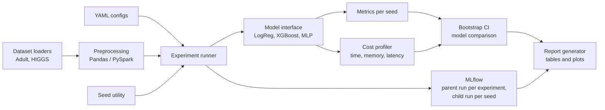

# MLBench: Implementation Plan

Reproducible ML benchmarking along three axes: predictive performance, computational cost, statistical reliability.

Deadline: Sunday 2026-11-08 (working days Thu to Sun, 5-6 focused hours per day).
Priority: polished GitHub repo first, concise technical report second.
Last updated: 2026-11-05 afternoon. For the current build status and next steps, see `handoff.md` and `todo.md`.

---

## 1. Scope

| Item | Decision |
| --- | --- |
| Datasets | Adult Income (fast iteration), HIGGS (1M-row seeded random sample for training; full 11M rows only for the Pandas vs PySpark benchmark) |
| Models | Logistic Regression (in PyTorch), XGBoost, MLP (PyTorch). TabNet is optional and only attempted if everything else is done |
| Seeds | 10 per model-dataset pair |
| Bootstrap | 10,000 resamples, percentile CI (BCa optional) |
| Spark | Google Colab first; WSL2 not planned |
| Dropped | Covertype, TARNet/DragonNet (possible later extension) |

Out of scope for this week: hyperparameter search beyond a small fixed setting per model, multi-node Spark, publishing a paper.

---

## 2. Environment split

| Task | Where |
| --- | --- |
| Development, Adult runs, unit tests | Local (Windows 11, i5-12450HX, 12 GB RAM, Python 3.12 venv) |
| GPU training and GPU benchmarks | Local RTX 2050 (4 GB VRAM) and Colab GPU, always reported separately |
| PySpark vs Pandas benchmark | Colab |
| MLflow tracking | Local SQLite file (`sqlite:///mlflow.db`, gitignored); Colab results saved to Drive and copied back as CSVs |
| Final experiment runs | Fixed configs, run once from a clean git commit, results committed |

Rules:
- GPU benchmarking and distributed preprocessing measure different things. Never mix them in one table.
- Record hardware info (CPU, RAM, GPU, driver, library versions, git commit) with every run so numbers from the laptop and Colab are never compared as if they came from the same machine.
- 4 GB VRAM limits MLP batch size and model width on the laptop. Keep models small.

---

## 3. Architecture



Text version of the same flow:

```
configs -> runner -> (loader -> preprocessing) -> model -> metrics + cost
                                    |                          |
                                 MLflow  <---------------------+
                                    |
                          statistics -> plots/tables -> README + report
```

---

## 4. Repository layout

Files marked (planned) do not exist yet.

```
mlbench/
  README.md                 (planned)
  implementation.md
  todo.md
  handoff.md
  pyproject.toml
  requirements-lock.txt
  configs/
    adult_logreg.yaml
    adult_mlp.yaml
    adult_xgb.yaml
    higgs_*.yaml            (planned)
  src/mlbench/
    seed.py                 # global seeding + determinism flags
    config.py               # YAML loading and validation
    data/
      base.py               # TabularSplit container shared by all loaders
      adult.py
      higgs.py              (planned)
      preprocess_pandas.py  (planned)
      preprocess_spark.py   (planned)
    models/
      base.py               # common interface: fit, predict_proba, name
      torch_trainer.py      # shared PyTorch training loop for logreg and mlp
      logreg.py
      mlp.py
      xgb.py
      factory.py            # build_model(cfg, seed)
    metrics.py              # accuracy, AUC, F1, log loss
    runner.py               (planned) multi-seed experiment loop
    stats/
      bootstrap.py          (planned) percentile (and optionally BCa) CIs
      compare.py            (planned) model comparison
    cost/
      profiler.py           (planned) time, throughput, memory, latency
    tracking.py             # MLflow helpers
    report/
      plots.py              (planned)
      tables.py             (planned)
  scripts/
    run_experiment.py
    summarize.py            (planned)
    run_spark_benchmark.py  (planned)
    make_report.py          (planned)
    quick_compare.py        # scratch sanity script, can be deleted
  notebooks/
    colab_spark_benchmark.ipynb   (planned)
    colab_gpu_benchmark.ipynb     (planned)
  tests/
    test_seed.py, test_config.py, test_logreg.py, test_mlp.py,
    test_metrics.py, test_xgb.py, test_factory.py, test_tracking.py
  results/                  # final CSVs and figures (committed)
    preds/                  # per-seed test predictions, used for test-row bootstrap
  report/
    mlbench_report.md       (planned)
```

Gitignored: `.venv/`, `data/` (project root only), `mlruns/`, `*.db`, `mlartifacts/`, `*.egg-info/`.

---

## 5. Component design

### 5.1 Reproducibility (seed.py)
- Seed `random`, `numpy`, `torch`, `torch.cuda`, and pass the seed to XGBoost.
- Set `torch.use_deterministic_algorithms(True)` and `CUBLAS_WORKSPACE_CONFIG=:4096:8` for GPU runs.
- Set `torch.backends.cudnn.benchmark = False`.
- Seed DataLoader workers and use a seeded `torch.Generator` (the shared trainer shuffles with its own seeded generator).
- Document that some GPU operations stay non-deterministic or get slower in deterministic mode. Measure and report the speed cost of deterministic mode once.
- Test: the same seed run twice on CPU must give identical metrics (done).

### 5.2 Data
- Adult: OpenML fetch cached as Parquet, `fnlwgt` dropped, missing categoricals become "Unknown", one-hot encode categoricals, standardize numerics, fixed stratified train/val/test split (80/10/10 of the data). The scaler and encoder are fit on the training split only to avoid leakage.
- HIGGS: UCI file (about 11M rows, 28 features, first column is the label). Convert once to Parquet. Draw a 1M-row seeded random sample with a fixed sample seed (separate from the training seeds), save it, and reuse the same sample for every model and seed. Then apply the same fixed stratified split procedure as Adult.
- Important: the data split is fixed, and only the training seed varies across the 10 runs, so seed variance reflects model and training randomness. State this in the report. (Optionally add a second experiment that also varies the split.)

### 5.3 Models
- One interface: `fit(X_train, y_train, X_val, y_val)` returning an info dict, and `predict_proba(X)` returning a 1-D array.
- Logistic Regression is a single linear layer in PyTorch, so it shares the training loop with the MLP (Adam, BCE loss, early stopping on validation loss, best epoch restored).
- MLP: hidden layers (128, 64), dropout 0.1.
- XGBoost: `hist` tree method, CPU and GPU (`device="cuda"`) variants, subsample and colsample both 0.8. These must stay below 1.0, otherwise XGBoost is almost deterministic and all seeds give identical results.
- Fixed small hyperparameter set per model, same tuning effort for every model, written in the config.

### 5.4 Runner
- For each (dataset, model): loop over seeds 0..9, train, evaluate on test, record metrics and cost.
- Save a tidy results CSV, one row per (dataset, model, seed, device), plus per-seed test predictions (`results/preds/<name>_<device>.npz`).
- Currently implemented in `scripts/run_experiment.py`; to be moved into `src/mlbench/runner.py`.

### 5.5 Statistics
- Percentile bootstrap CI over per-seed test metrics (10,000 resamples) for each model.
- Comparison between models across seeds: seed k of one model has no special link to seed k of another, so the seeds are NOT paired. The difference in means is bootstrapped by resampling each model's seeds independently, and the CI of the difference is reported with whether it excludes zero.
- Bootstrap over test rows: resample the test examples (using the saved predictions) to get a CI for each model's AUC. This captures test-set sampling uncertainty, which is usually wider than seed variance, and it must be reported separately from seed variance. Because all models are scored on the same test rows, model differences can be bootstrapped paired over rows.
- With 10 seeds the seed-based CIs are only a rough guide. State this explicitly.

### 5.6 Cost profiling
- Warmup iterations discarded before timing.
- `torch.cuda.synchronize()` before and after every timed GPU region.
- Metrics: training wall-clock, inference throughput (samples/s), per-batch latency (p50, p95), peak host memory, peak GPU memory (`torch.cuda.max_memory_allocated`).
- Repeat timings several times and report mean and spread, not a single run.
- XGBoost on GPU: keep the data on the GPU while timing prediction. With NumPy input every predict call copies CPU to GPU, so the timing would mostly measure the copy.
- Run CPU and GPU separately and record the hardware.

### 5.7 Pandas vs PySpark benchmark (Colab)
- Pipeline: read raw HIGGS, type cast, drop nulls, standardize features, write Parquet.
- Sizes: 1M, 5M, 11M rows.
- Measure: wall-clock, peak memory, and the effect of partition count (for example 4, 8, 16, 32).
- Expectation to test, not assume: 11M x 29 float64 is roughly 2.5 GB, so Pandas will probably fit in memory. Spark has startup and shuffle overhead, so it may be slower at this scale. Report whatever is found.
- Also compare CSV vs Parquet read time, since the file format likely matters as much as the engine.

### 5.8 MLflow
- Local SQLite backend (`sqlite:///mlflow.db`). One experiment per dataset. Parent run per (model, config), child run per seed.
- Log: params (config, seed, device), metrics (accuracy, AUC, F1, log loss, cost metrics, per-model mean and std across seeds), tags (git commit with a `-dirty` suffix if uncommitted changes exist, Python, OS, CPU, RAM, GPU, library versions), artifacts (config file, results CSV).
- Browse with `mlflow ui --backend-store-uri sqlite:///mlflow.db` (run it in a second terminal). On Windows, `Ctrl+C` can hang while a browser tab is connected; close the tab or the terminal.
- Delete `mlflow.db` before the final runs so development runs do not mix with reported results.
- Colab runs are exported as CSVs and merged back.

---

## 6. Report outline (concise, 4-6 pages)

1. Problem and motivation
2. Methodology (datasets, models, seeds, splits)
3. Statistical approach (seed bootstrap, test-row bootstrap, model differences, caveats)
4. Cost measurement protocol
5. Results: accuracy with CIs, cost vs accuracy, CPU vs GPU, Pandas vs Spark scaling
6. Limitations (few seeds, small hardware, single split, free-tier Colab variability)
7. Reproduction instructions

---

## 7. Risks and mitigations

| Risk | Mitigation |
| --- | --- |
| PySpark setup time | Colab only; pin `pyspark` version; do not touch Windows Spark |
| 4 GB VRAM limit | Small MLP, modest batch size, subset of HIGGS |
| Colab variability (shared hardware, session resets) | Record hardware per run, repeat timings, save results to Drive after every run |
| GPU non-determinism | Deterministic mode plus documented residual variance |
| Time overrun | TabNet and BCa intervals are optional; cut the second experiment (varying split) first |
| MLflow UI hangs on Windows | Run it in a separate terminal, close the browser tab before stopping it, results are safe in the database either way |
| Final runs from a dirty git state | Commit before the final runs so the git commit tag has no `-dirty` suffix |

---

## 8. Definition of done

- A fresh clone plus one documented command reproduces one Adult result.
- All 3 models x 2 datasets have 10 seeds logged in MLflow.
- Results table with bootstrap CIs and at least one model comparison.
- CPU vs GPU cost table (local and Colab reported separately).
- Pandas vs Spark scaling table and plot.
- README with architecture diagram, quickstart and results summary.
- Technical report covering methodology and limitations.
- Cleaned `requirements-lock.txt` that reinstalls on another machine.
